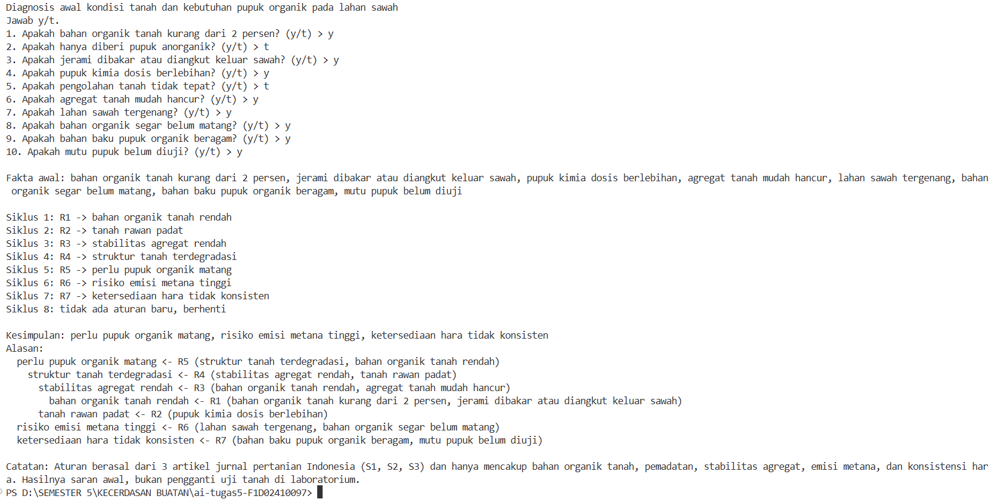
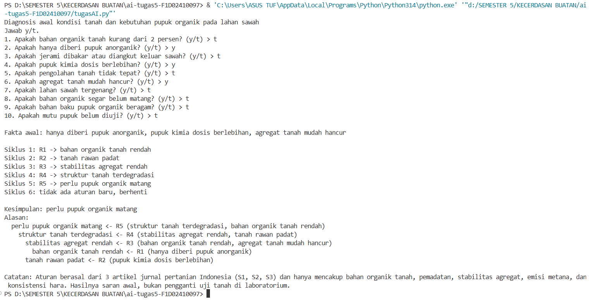
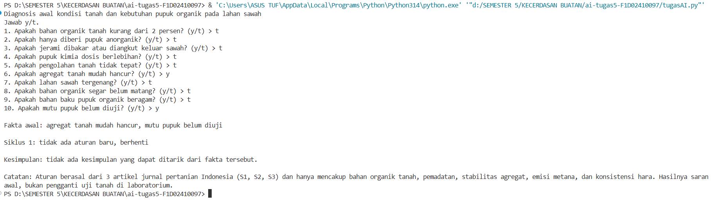

# ai-tugas5-F1D02410097

## Nama: Tegu Ilham Pebrian Saputra
## NIM : F1D02410097

## Topik dan cara menjalankan program
Topik: diagnosis awal kondisi tanah pada lahan sawah dan kebutuhan pupuk organik.
Program menanyakan kondisi lahan (misalnya bahan organik tanah, pemupukan, pengolahan tanah, dan jenis bahan organik), lalu menyimpulkan masalah tanah beserta alasannya.

## Daftar Sumber
| Kode | Judul | Penerbit | URL | Tanggal akses |
| :--- | :--- | :--- | :--- | :--- |
| S1 | Mendrofa, M. T. & Gulo, D. (2024). Pengaruh Pupuk Organik terhadap Perbaikan Struktur dan Stabilitas Tanah | PENARIK: Jurnal Ilmu Pertanian dan Perikanan | [https://doi.org/10.70134/penarik.v2i2.72](https://doi.org/10.70134/penarik.v2i2.72) | [10 Nov 2026] |
| S2 | Zebua, T., Gulo, S. M. & Gulo, S. S. (2025). Pengaruh Pupuk Organik Terhadap Pertumbuhan Tanaman dan Kualitas Tanah | Flora: Jurnal Kajian Ilmu Pertanian dan Perkebunan | [https://doi.org/10.62951/flora.v2i1.268](https://doi.org/10.62951/flora.v2i1.268) | [10 Nov 2026] |
| S3 | Wihardjaka, A. & Harsanti, E. S. (2021). Dukungan Pupuk Organik untuk Memperbaiki Kualitas Tanah pada Pengelolaan Padi Sawah Ramah Lingkungan | Balai Penelitian Lingkungan Pertanian | [https://doi.org/10.33964/jp.v30i1.496](https://doi.org/10.33964/jp.v30i1.496) | [10 Nov 2026] |

## Tabel Aturan
| ID | Jika | Mode | Maka | Sumber |
| :--- | :--- | :--- | :--- | :--- |
| R1 | bahan organik tanah kurang dari 2 persen; hanya diberi pupuk anorganik; jerami dibakar atau diangkut keluar sawah | atau | bahan organik tanah rendah | S3 |
| R2 | pupuk kimia dosis berlebihan; pengolahan tanah tidak tepat | atau | tanah rawan padat | S1 |
| R3 | bahan organik tanah rendah; agregat tanah mudah hancur | dan | stabilitas agregat rendah | S1 |
| R4 | stabilitas agregat rendah; tanah rawan padat | dan | struktur tanah terdegradasi | S1 |
| R5 | struktur tanah terdegradasi; bahan organik tanah rendah | dan | perlu pupuk organik matang | S3 |
| R6 | lahan sawah tergenang; bahan organik segar belum matang | dan | risiko emisi metana tinggi | S3 |
| R7 | bahan baku pupuk organik beragam; mutu pupuk belum diuji | dan | ketersediaan hara tidak konsisten | S2 |

## Metode Forward Chaining
Program memulai dari fakta yang dijawab 'y' atau 't' oleh pengguna, menjalankan aturan yang syaratnya terpenuhi, menambahkan hasilnya ke memori, dan mengulang sampai tidak ada aturan baru yang cocok. Aturan yang hasilnya sudah ada di memori tidak dijalankan lagi, sehingga program pasti berhenti. Setiap hasil dicatat berasal dari aturan mana, dan catatan itu dipakai untuk menampilkan alasan kesimpulan.
Saya memilih metode Forward Chaining karena berdasarkan kasus yang saya gunakan pengguna biasanya hanya mengetahui kondisi yang teramati di lahan tetapi belum tahu masalah tanahnya. Untuk itu FC cocok untuk alur dari fakta menuju kesimpulan. Selain  itu, satu kumpulan fakta dapat menghasilkan lebih dari satu kesimpulan sekaligus (misalnya kebutuhan pupuk organik dan risiko emisi metana). FC menemukan semuanya dalam satu kali jalan.

## Uji Kasus

## Batas Keberlakuan
Pengetahuan dalam sistem ini berasal dari tiga artikel jurnal ilmiah (Mendrofa dan Gulo, 2024; Zebua dkk., 2025; Wihardjaka dan Harsanti, 2021), jadi aturan mencerminkan temuan para penulis tersebut, bukan pakar yang diwawancarai langsung. Sistem hanya berlaku untuk diagnosis awal lahan pertanian (terutama sawah) di Indonesia dan hanya mencakup bahan organik tanah, pemadatan, stabilitas agregat, emisi metana, dan konsistensi hara; jenis tanah, iklim, dan jenis tanaman tidak dibedakan, dan sistem tidak menghitung takaran pupuk. Hasilnya adalah saran awal, bukan keputusan akhir, dan perlu dikonfirmasi dengan uji tanah di laboratorium atau penyuluh pertanian.

## Penggunaan AI
Saya menggunakan AI untuk membantu menyelesaikan program Forward Chaining terutama pada bagian method def forward_chaining(aturan, memori), dan juga membatu menemukan penyebab eror yang terjadi.
